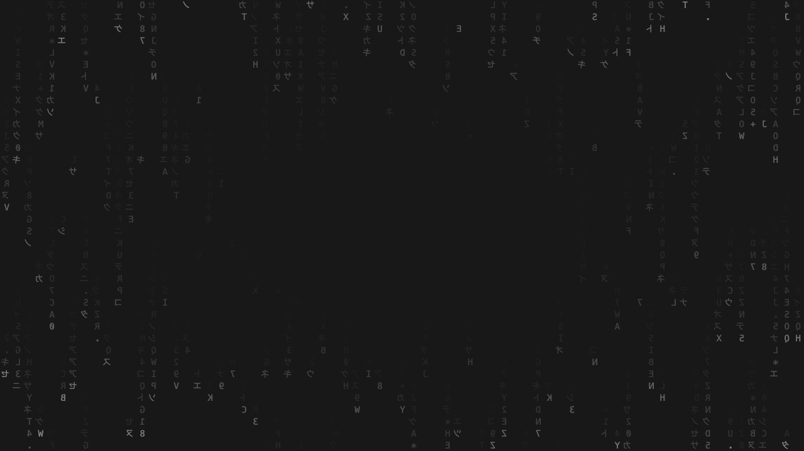

# Grey Code Rain



Double-click `index.html` to open it offline. "Original rhythm" is selected by default. The animation is rebuilt from the Codex Code Review front-end rules found on this machine.

You can also run `python3 -m http.server 8765 --bind 127.0.0.1` in the project directory and open <http://127.0.0.1:8765/>. No dependencies or build step.

Defaults: speed 1, brightness 1, font size 14 px, density 1, centre fade 1. Click "Restore original" after adjusting to return to these values. Brightness 1 corresponds to a canvas-wide opacity of 45%.

Original rhythm uses a fixed character grid. Each column carries three short chains, an independent fall speed (3–12 cells per second) and an independent character-change interval (0.07–0.67 s). Every character is mirrored horizontally. Chain head and tail brightness and the radial mask follow the original algorithm on this machine. The default grid is at least 18 × 19 px, adapting to the measured glyph size and canvas dimensions, capped at 128 columns and 72 rows.

A stepped mode and controls for speed, brightness, font size, density and centre fade are also provided. Stepped mode is an extension; restoring the original returns to the original rhythm. Changing the font size adjusts grid spacing accordingly while keeping the density cap. Font rendering depends on the browser and system fonts, so this is not a pixel-for-pixel screenshot copy.

## Embedding in your own page

```html
<div class="hero">
  <canvas id="rain" aria-hidden="true"></canvas>
  <div class="hero-content">Your heading and buttons</div>
</div>
<style>
  .hero { position: relative; min-height: 600px; overflow: hidden; background: #181818; }
  #rain { position: absolute; inset: 0; width: 100%; height: 100%; color: #fff; pointer-events: none; }
  .hero-content { position: relative; z-index: 1; }
</style>
<script src="code-rain.js?v=original-model-8"></script>
<script>
  const rain = new CodeRain(document.getElementById('rain'), {
    speed: 1,
    brightness: 1,
    fontSize: 14,
    density: 1,
    centerFade: 1,
    motion: 'original',
    background: '#181818'
  });
</script>
```

`rain.setOptions({ fontSize: 16 })` adjusts parameters live. `rain.setPaused(true)` pauses. `rain.reset()` restores the original defaults. Call `rain.destroy()` before removing the component to release resources. Pass a fixed `seed` for a reproducible chain layout.

Parameter ranges: speed 0–12, brightness 0–3 (preview max 2.6), font size 9–24 px, density 0.25–1.5, centre fade 0–1. Speed and brightness 1 are the original baseline multipliers. Brightness scales the whole layer's opacity, up to 100%.

No dependencies, no network requests. Adapts to device pixel ratio and caps the canvas pixel budget. Stops drawing while the page is in the background. Shows a static frame when the system "reduce motion" setting is enabled.

## Verification

The independently rebuilt default model was compared against the original model inside the local app package, at identical seed, canvas size and glyph size. Four seeds, three canvas sizes and eleven moments — 132 output groups in total; every character's position, content and opacity matched exactly. The mirrored glyph atlas, default opacity and mask, adjustments, pause, restore and destroy paths were checked as well.
